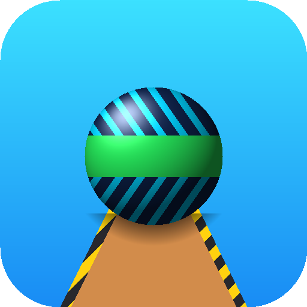

# Rolling Quest 🎮

<p align="center">
  
</p>

<p align="center">
  <b>A high-octane, physics-driven 3D mobile rolling ball platformer inspired by <i>Going Balls</i>.</b><br/>
  Precision steering • Lethal mechanical traps • Mid-air ramp jumps • Billowing procedural cloud ocean
</p>

<p align="center">
  
  
  
  
  
  
</p>

---

## 📖 Overview

**Rolling Quest** is a commercial-grade 3D ball platformer engineered from the ground up for mobile touchscreens and desktop. Built in **Godot Engine 4** with **Jolt Physics**, it abandons scripted rails in favor of **100% force-driven rigid body dynamics**. Every acceleration, steering nudge, ramp launch, and trap collision is mathematically calculated in real-time.

Players guide a heavy arcade ball down a suspended 240-meter obstacle course hovering high above a procedural cloud ocean. Precision is mandatory: narrow 2.2m bridges, sudden hydraulic piston slammers, 4-blade revolving turnstiles, and turbulent crosswinds constantly threaten to knock you into the abyss below.

---

## ✨ Key Features

### ⚙️ Physics & Ball Dynamics
- **Pure Force-Driven Control:** Uses proportional force controllers (`apply_central_force`, `apply_central_impulse`) rather than direct coordinate translation, preserving angular momentum, surface grip, and physical spin.
- **Calibrated Tactical Pace:** Tuned to a controlled **$6.8\text{ m/s}$ cruising speed**—fast enough to keep adrenaline pumping, yet deliberate enough for high-stakes navigation.
- **Athletic Jump Mechanic:** Tight $0.7\text{m}$ athletic hop (`jump_impulse = 3.6`) with ground raycasting. Perfect for clearing small hazards and timing ramp lip launches, but cannot be exploited to skip tall obstacles.
- **Neon Speed Boost Pads:** Emissive warp strips that surge the ball forward at **$13.5\text{ m/s}$**, launching it into high-velocity trajectory jumps over mid-air ocean gaps.

### 💥 Lethal Obstacles & Trap Gauntlet
- **Hydraulic Piston Slammers:** Wall-mounted industrial rams that flash warning beacons, rumble with anticipation, and violently punch across the track in $0.12\text{s}$, batting careless players straight into the void.
- **Oscillating Sweeper Wiper:** A 2.3-meter motorized hazard blade that sweeps across the entire width of the Narrow Ridge—forcing players to wait for an opening or risk being swept away.
- **4-Blade Revolving Turnstiles:** 3.2m-tall rotating cross-blades spanning the full width of the platform that cannot be jumped over; players must read the rotation rhythm and slip through open quadrants.
- **Giant Pendulum Mallets:** Heavy swinging overhead hammers that sweep across the track like grandfather clock pendulums.
- **Arcade Pinball Bounce Bumpers:** Glowing neon bumpers that explosively repel the ball ($14\text{ N}$ impulse + squish-and-stretch tween) upon contact.
- **Dynamic Crosswind Zone:** Turbulent lateral wind gusts ($18\text{ N} \pm 6\text{ N}$) across a razor-thin 2.2m bridge requiring active counter-steering.
- **Heavy Cargo Crates:** Heavy wooden obstacles that block straight lines, punish corner grazing, and stop bulldozing momentum dead in its tracks.

### 🔊 High-Fidelity Acoustic Audio System
- **Speed-Modulated Ball Rolling (`rolling.wav`):** Continuous physical wooden surface rumble whose pitch ($78\text{--}180\text{ Hz}$) and volume dynamically scale with the ball's actual velocity. Automatically drops to silence when airborne for realistic weightlessness.
- **Metallic Coin Chime (`coin.wav`):** Resonant metal disk acoustics with partials at $2380\text{ Hz}$ and physical strike transients.
- **Pneumatic Slammer Impact (`slam.wav`):** High-pressure pneumatic air blast followed by a heavy $48\text{ Hz}$ sub-bass anvil impact.
- **Kinetic Jump Whoosh (`jump.wav`):** Low-frequency kinetic hop compression paired with an aerodynamic air rush.
- **Polyphonic 4-Voice Player Pool:** Audio coordinator that guarantees simultaneous coin pickups, speed boosts, and trap strikes never cut each other off.

### ☁️ Atmospheric Visuals & Shaders
- **Procedural Rolling Cloud Ocean:** Custom GLSL fragment shader (`cloud_sea.gdshader`) undulating below the track, replacing empty void planes with a living sea of clouds.
- **Atmospheric Distance Fog:** Linear exponential depth fog ($50\text{m} \to 260\text{m}$) blending seamlessly into the procedural sky dome.
- **Mobile-Optimized Post-Processing:** Subdued bloom and emission glow on boost pads, hazard turnstiles, and checkpoint arches with minimal GPU overhead.

---

## 🗺️ Course Breakdown (Level 01 — 240m Gauntlet)

| Sector | Span | Track Width | Key Hazards & Highlights |
|---|---|---|---|
| **1. Ocean Runway** | $0\text{m} \to -35\text{m}$ | $3.6\text{m}$ | Cargo crates, moving hazard slider, Ambush Piston Slammer #1, Speed Boost Pad #1 |
| **🚀 Ocean Gap #1** | $-35\text{m} \to -53.5\text{m}$ | Ramp ($18^\circ$) | **9m mid-air flight** over the cloud sea with 3 airborne collectible coins |
| **2. The Island Terrace** | $-53.5\text{m} \to -105\text{m}$ | $3.6\text{m}$ | Pendulum Mallet #1, Pinball Bumpers, Alternating 1-2 Piston Slammers, 4-Blade Clockwise Turnstile, Speed Boost Pad #2 |
| **🚀 Canyon Gap #2** | $-105\text{m} \to -123.5\text{m}$ | Ramp ($18^\circ$) | **High-velocity flight** over a deep ocean chasm |
| **3. The Narrow Ridge** | $-123.5\text{m} \to -165\text{m}$ | **$2.2\text{m}$ (Razor-thin)** | Barely 2.5 ball widths wide; Pendulum Mallet #2, Crosswind Zone ($18\text{ N}$), Sweeper Wiper Bar, Edge Bumper |
| **4. The Grand Speedway** | $-165\text{m} \to -235\text{m}$ | $3.6\text{m}$ | Boost Pad #3, Rapid Hazard Slider, Counter-Clockwise Turnstile, Ambush Piston Slammer #4, Double Crates, Finish Gate |

---

## 🕹️ Controls

<div align="center">

| Action | Desktop (Keyboard & Mouse) | Mobile (Touch & Motion) |
|---|---|---|
| **Steer Left / Right** | `A` / `D` or `Left` / `Right` Arrow Keys | **Single-finger Drag / Swipe** on screen |
| **Tilt Steering** | — | **Phone Accelerometer / Gyro** tilt |
| **Athletic Hop / Jump** | `Spacebar` or `Up` Arrow | **Quick Tap** or **Swipe Up** anywhere |
| **Pause / Resume** | `Esc` or Pause Button | **Pause Button** in HUD |

</div>

> **Physics Principle:** Steering inputs apply normalized lateral forces to the rigid body. Counter-steering damps drift naturally, providing a tactile, responsive feel across all devices.

---

## 🛠️ Tech Stack & Specifications

```text
Engine:              Godot Engine 4.7.2 Standard (macOS / Windows / Linux)
Scripting Language:  GDScript 2.0 (Strictly Typed)
Physics Backend:     Jolt Physics 3D (Deterministic, Multi-Threaded)
Render Pipeline:     GL Compatibility (Optimized for broad Mobile Adreno / Mali GPUs)
Target Resolution:   Portrait (1080 × 1920) with Responsive Viewport Expand Mode
Target Frame Rate:   60 FPS locked on Android API 24+ devices
```

---

## 🏗️ Architecture & Directory Layout

The project follows a modular, decoupled architecture where scenes, scripts, singletons, and assets are cleanly isolated:

```text
rolling-quest/
├── assets/                          # Raw & imported multimedia assets
│   ├── audio/                       # 16-bit 44.1kHz WAV SFX (rolling, coin, jump, slam, boost, etc.)
│   ├── fonts/                       # Typography resources
│   ├── materials/                   # Shared StandardMaterial3D configurations
│   ├── models/                      # 3D meshes and props
│   └── textures/                    # 512x512 textures (ball, track wood, crates, hazard stripes, etc.)
├── docs/                            # Technical specifications & design docs
│   └── game_design.md               # Detailed Game Design Document (GDD)
├── scenes/                          # Reusable instantiable scene trees (.tscn)
│   ├── collectibles/                # Coin mesh, rotation logic, collection triggers
│   ├── environment/                 # Cloud sea procedural GLSL shader & water mesh
│   ├── levels/                      # Level 01 master scene tree
│   ├── main/                        # Root orchestrator: lighting, sky, camera, player, HUD
│   ├── obstacles/                   # Crates, turnstiles, hammers, slammers, bumpers, wipers
│   ├── player/                      # Ball RigidBody3D, colliders, touch controller
│   ├── track/                       # Boost pads, platforms, ramps, finish gate
│   └── ui/                          # HUD overlay, score tracker, victory / game over dialogs
├── scripts/                         # Strongly-typed GDScript source code
│   ├── camera/                      # Smooth look-ahead tracking camera controller
│   ├── collectibles/                # Coin collection handler & animation
│   ├── game/                        # Autoload singleton GameManager (scores, audio pool, lifecycle)
│   ├── input/                       # Touch swipe, mouse drag, and accelerometer bridge
│   ├── level/                       # Procedural level builder, gap geometry, triggers
│   ├── obstacles/                   # Trap state machines (pistons, sweepers, hazards)
│   ├── player/                      # Proportional force physics ball controller
│   ├── track/                       # Speed boost warp mechanics
│   └── ui/                          # Live HUD presentation controller
├── export_presets.cfg               # Pre-configured Android APK export preset
├── icon.png                         # 512×512 HD app launch icon
└── project.godot                    # Engine configuration & autoload registry
```

---

## 🚀 Getting Started

### Prerequisites
- [Godot Engine 4.7.2 Standard](https://godotengine.org/download) (or latest Godot 4.x)
- Git & Git LFS

### Running Locally
1. **Clone the repository:**
   ```bash
   git clone https://github.com/Ashish5180/rolling-quest.git
   cd rolling-quest
   ```
2. **Open Godot Engine** and click **Import**.
3. Select the `project.godot` file in the repository root.
4. Press **Run Project** (`F5` or `Fn + F5` on macOS) to launch the game!

---

## 📱 Android Export & Build Instructions

The project includes a ready-to-use export configuration in `export_presets.cfg`:

1. **Install Android Export Templates:**
   - In Godot Editor: **Editor → Manage Export Templates → Download and Install**.
2. **Configure SDK Paths** (one-time setup):
   - In Godot Editor: **Editor → Editor Settings → Export → Android**:
     - `Android SDK Path`: Path to your Android SDK (e.g., `~/Library/Android/sdk` on macOS or `C:/Users/<User>/AppData/Local/Android/Sdk` on Windows).
     - `Java SDK Path`: Path to OpenJDK 17+.
3. **Export the APK:**
   - Open **Project → Export...**
   - Select the pre-configured **"Android"** preset (configured with `com.ashish.rollingquest`, portrait orientation, and `icon.png`).
   - Click **Export Project** → Choose output filename (e.g. `build/RollingQuest.apk`) → **Save**.
4. **Instant 1-Click Device Deployment:**
   - Connect your Android phone with **USB Debugging** enabled.
   - Click the **Android Robot Icon** in the top-right toolbar of the Godot Editor for instant wireless or USB test deployment!

---

## 🗺️ Roadmap & Milestones

- [x] **Milestone 0: Project Architecture & Environment Setup**
- [x] **Milestone 1: Core Ball Physics & Keyboard Steering Prototype**
- [x] **Milestone 2: Touch Input Controller, Gyro Tilt & Tracking Camera**
- [x] **Milestone 3: 240m Floating Track, Open Skyways & Physics Ramp Air Gaps**
- [x] **Milestone 4: Core Gameplay Loop (Turnstiles, Crates, 35 Coins, Athletic Jumps)**
- [x] **Milestone 5: Visual Styling, Embossed Gold Coins, Rolling Cloud Sea & Sky**
- [x] **Milestone 6: UI System, Live Coins/Score HUD, Overlays & Polyphonic Audio**
- [x] **Milestone 7: Android Export Preset, 512×512 HD Icon & Mobile Build Config**
- [x] **Milestone 8: High-Threat Hazards (Hydraulic Pistons, Wiper Sweeper, Pinball Bumpers, Wind)**
- [x] **Milestone 9: Precision Physics Calibration (6.8 m/s Pace, 3.6m/2.2m Track Proportions)**

---

## 🤝 Contributing

Contributions, feature requests, and bug reports are welcome! Feel free to open an issue or submit a pull request to help make *Rolling Quest* even better.

---

## 📄 License

This project is licensed under the **MIT License**. See [LICENSE](LICENSE) for details.

<p align="center">
  Crafted with passion for high-performance mobile gaming. 🎮
</p>
